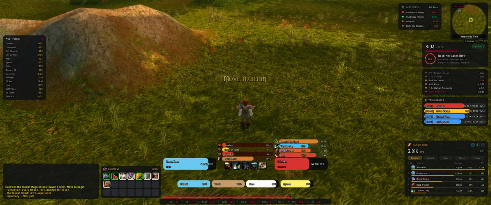
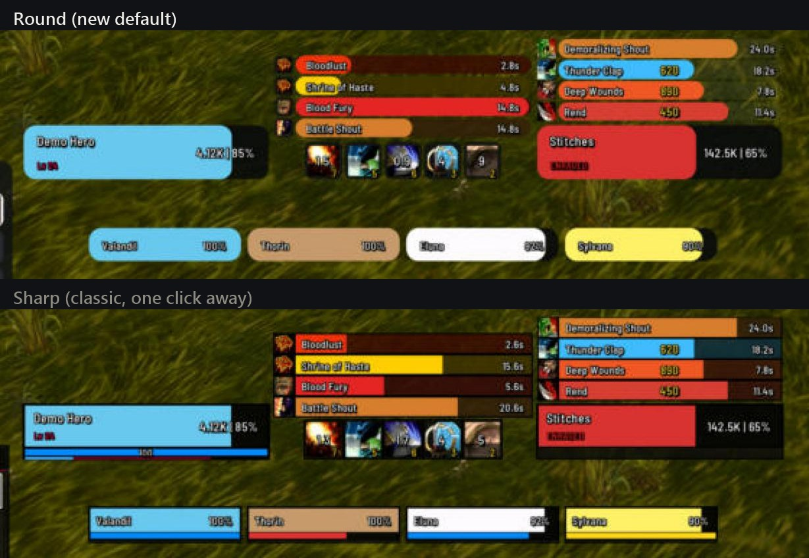
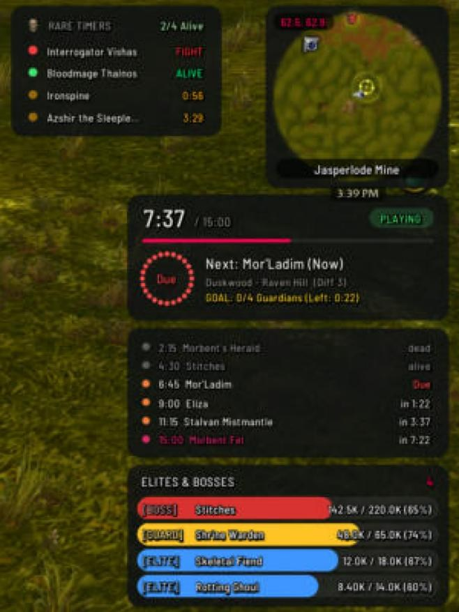
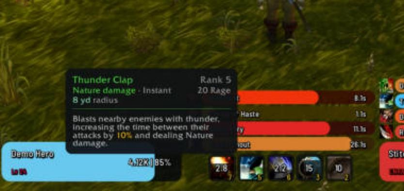
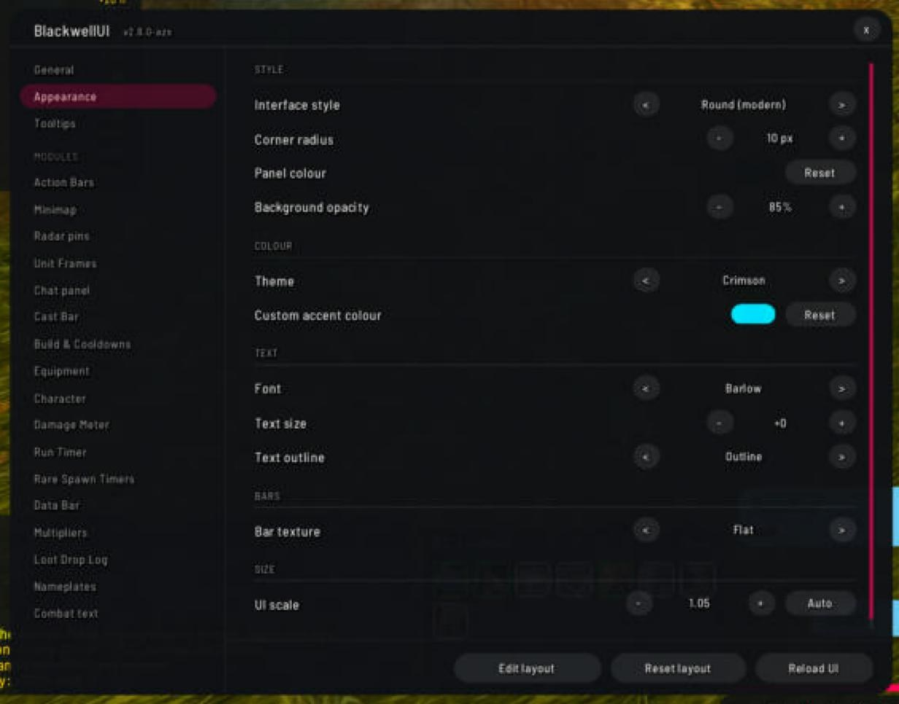
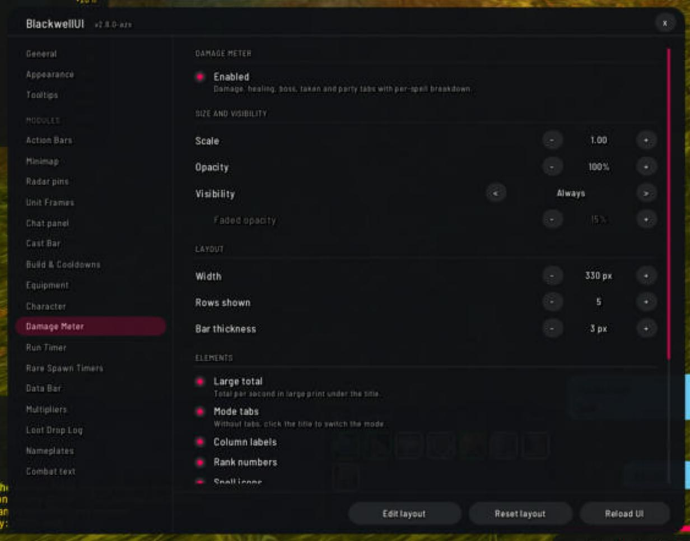
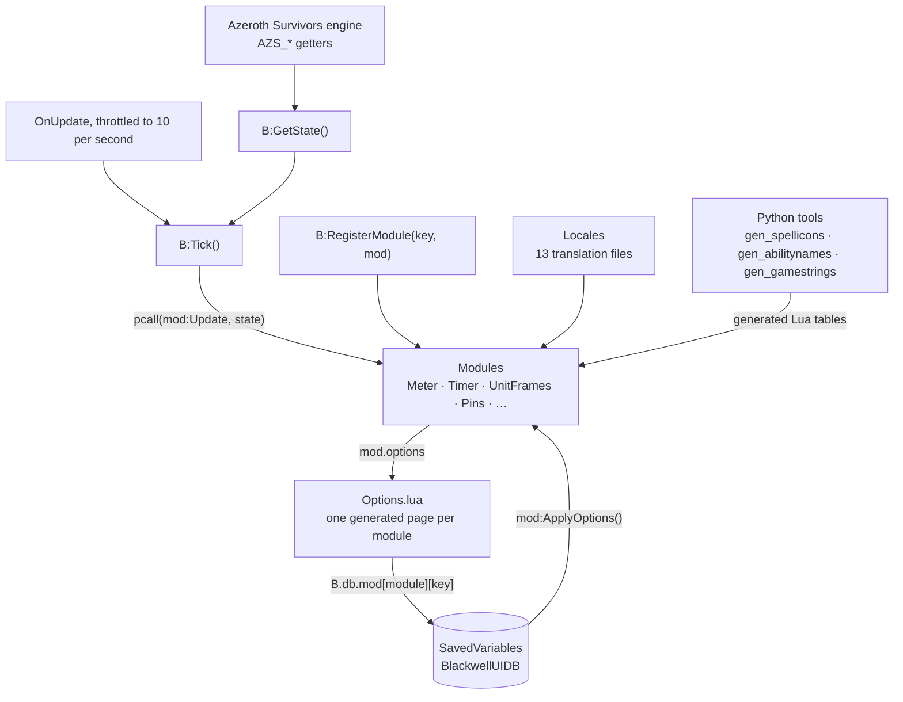

# BlackwellUI

**The tactical HUD and run-analytics suite for Azeroth Survivors.** 
See every number that decides a run: who deals the damage, when the next boss spawns, where the caches are.

&nbsp;

[What's new](#whats-new-in-28) · [Screenshots](#screenshots) · [Features](#features) · [Installation](#installation) · [Commands](#commands) · [FAQ](#faq) · [Report a bug](https://github.com/Blackwellcode/BlackwellUI/issues/new/choose)

---

## Why BlackwellUI

Azeroth Survivors turns the 1.12.1 client into a horde-survival roguelite: spells fire on their own, the screen fills with enemies, and a run is won or lost on build decisions. The stock interface was made for a different game.

BlackwellUI replaces it with one clean HUD that puts the run in front of you:

| | |
|---|---|
| **Know your damage** | A five-tab meter (Damage, Healing, Boss, Taken, Party) with share, DPS, biggest crit and item-proc merging. |
| **Know the clock** | Run timer with a countdown ring to the next boss, the full boss schedule and the "4 Guardians before 8:00" goal. |
| **Know the map** | Minimap radar pins for caches and guardian lairs, rare spawn timers and a live elites & bosses tracker. |
| **Make it yours** | Round or classic sharp style, 200+ settings, every frame movable on a 32px grid, any accent colour. |
| **Speaks your language** | Follows the game's language automatically: English, Deutsch, Français, Español, Português (Brasil), Polski, Čeština, Română, Türkçe, Русский, Українська, 简体中文, 日本語, 한국어. |

---

## What's new in 2.8

- **A new round look for every frame.** Panels, bars, buttons, tooltips, the character window and the control center are redrawn with rounded corners and a calmer, modern layout. Unit frames are one full health bar each, as in the classic layout, now with rounded corners.
- **The classic sharp style is one click away** (`/bw` → Appearance → Interface style). Both styles share every setting.
- **200+ settings.** Each of the 17 modules has its own page with size, opacity and visibility (always, in combat, out of combat, or faded until mouse-over) plus its own options: rows and columns of the meter, health text formats, tile size, data bar items, chat timestamps, minimap clock, combat text sizes, nameplate layout and many more.
- **Enemy colours that mean something.** Bosses red, rare guardians yellow, elites blue, normal enemies violet, the final boss crimson; the same colours on the target frame, the elites & bosses list and the nameplates, all adjustable.
- **A thicker XP line** above the data bar (2 to 12 px, 6 px by default).
- **A welcome line in your language** when you log in (can be turned off).
- **Built-in checks for bug reports:** `/bw selftest` tries every setting and reports errors, `/bw layoutcheck` lists frames that overlap.

---

## Screenshots

The same layout in the new round style (top) and the classic sharp style (bottom).

  

**Left:** rare timers, minimap, run clock with a countdown ring to the next boss, boss schedule, elites & bosses in their enemy colours. **Right:** spell tooltip with damage school, range, upgrades and talents.

  

The control center (`/bw`): General, Appearance and Tooltips, then one scrollable page per module.

---

## Features

<b>Combat analytics</b>

- **Damage meter** with five tabs: Damage, Healing, Boss, Taken, Party. Click the title to cycle, or a tab to jump.
- **Hover breakdown** per spell: damage, DPS, share of the total and biggest crit.
- **Proc merging** (`M` button): folds item procs such as `Amulet of the Inferno: Consecration` into the spell they belong to.
- **Session reset** (`R` button): left-click starts a fresh session, right-click returns to run totals.
- **Party drilldown**: in the Party tab, click a player to see their spells, hits and crits.
- **Floating combat text** in its own style: outgoing and incoming numbers, multi-hit merging (`223 (9 Hits)`), ability alerts, sizes and timings to taste. Blizzard's numbers come back as soon as you turn it off.

<b>Run intelligence</b>

- **Run clock** with run length, zone and difficulty, a countdown ring to the next boss and the full boss schedule.
- **Guardian goal**: tracks the "4 Guardians before 8:00" objective right in the timer.
- **Elites & bosses tracker** with HP and percent in enemy colours; click a row to target it.
- **Rare spawn timers** for every lair: alive, fighting, or the time until respawn.
- **Data bar** along the bottom: level, XP, kills with a rolling kill pace (`[57/m]`), gold, lives, total damage and FPS; pick which items show.
- **Loot log** with quality colours and run timestamps.

<b>Unit frames</b>

- **Hero, target, target of target, pet and party frames**: one full health bar each, with name, level or status and health text inside.
- **Enemy colours** on the target: boss red, rare guardian yellow, elite blue, normal enemy violet, final boss crimson. Players show in their class colour.
- **Target debuff bars** with tick damage and timers above the target frame.
- Health text as value, percent, both, current / max or hidden; widths, heights, text size and every element switchable.

<b>Your build</b>

- **Spell tiles** with cooldown overlays, rank badges and full tooltips including all upgrades; tile size, spacing and growth direction to taste.
- **Buff bars** above the tiles for shrines, racials and procs.
- **Level-up button**: with stored level-ups, a `LEVEL UP READY (N)` button appears above your spells.
- **Equipment panel** with every equipped item and a quality ring.
- **Stat multipliers** panel: damage, cooldown, crit, area, speed, echo and more, read live from the game; choose rows, colours and growth direction.

<b>Layout & style</b>

- **Round or sharp style**, corner radius, panel colour, background opacity, font, text size, text outline and bar texture.
- **Themes**: Blackwell, Crimson, Amber, Emerald, Violet, Monolith, class colour or any custom colour.
- **Per-module size, opacity and visibility**: always, only in combat, only out of combat, or faded until the mouse is over it.
- **Edit mode** with labelled movers, a 32px alignment grid and centre axes.
- **Auto scaling** that fits the layout to your resolution, or a fixed scale (`/bw scale 0.9`).
- **Tooltips** in the HUD style, positioned next to the HUD, at the cursor or where the game puts them, with class and reaction colours.
- **Minimap, radar pins, chat and nameplates** in the same style, each with its own settings.
- **14 languages**, detected from the game's own language setting. Spell names on your tiles follow the game's language too. Override it in `/bw` (General, Language) or with `/bw lang de`.

---

## Installation

### Windows client (`AzerothSurvivors.exe`)

1. [Download `BlackwellUI.zip`](https://github.com/Blackwellcode/BlackwellUI/releases/latest/download/BlackwellUI.zip).
2. Extract it so that the folder sits at `AzerothSurvivors\benilla-config\AddOns\BlackwellUI\` (the `.toc` file must be directly inside `BlackwellUI`).
3. Start the game and enter a zone. Type `/bw` for the control center.

### Browser client (WebGPU)

Install `BlackwellUI.zip` through the game's in-game **AddOns** dialog, then reload.

### Updating

Download the new zip and replace the `BlackwellUI` folder. Your settings live in `benilla-config\saved\BlackwellUI.lua` and are kept.

### Uninstalling cleanly

BlackwellUI hides the stock run HUD and Blizzard's floating damage numbers. Those are game settings, and the client only saves them while you play. **Before you delete the addon**, open `/bw`, switch off **Combat text** (its module page) and **Replace the stock run HUD** (General page); the game gets its own settings back straight away. Then remove the folder.

---

## Commands

| Command | Action |
|---|---|
| `/bw` | Open the control center (also `/bui`, `/blackwell`) |
| `/bw unlock` · `/bw lock` | Enter / leave edit mode |
| `/bw reset` | Reset all frame positions |
| `/bw grid` | Toggle the alignment grid in edit mode |
| `/bw demo` | Preview mode with sample data, useful for building a layout |
| `/bw hud` | Toggle replacing the stock run HUD |
| `/bw sct` | Toggle floating combat text |
| `/bw pins` · `/bw loot` · `/bw rares` · `/bw gear` · `/bw plates` | Toggle radar pins, loot log, rare timers, equipment panel, nameplates |
| `/bw buffs` | Toggle the buff bars above the spell tiles |
| `/bw autoscale` · `/bw scale 0.9` | Automatic or fixed UI scale (0.5 to 2.0) |
| `/bw lang` · `/bw lang de` · `/bw lang auto` | Show or set the interface language (applies after `/reload`) |
| `/bw selftest` | Try every setting once and report errors (settings are restored afterwards) |
| `/bw layoutcheck` | List HUD frames that overlap |
| `/bw help` | List all commands in chat |

---

## Compatibility

| | |
|---|---|
| Game | Azeroth Survivors (benilla engine, WoW 1.12.1 interface `11200`) |
| Windows client | Tested in-game on the 2026-11-01 client build |
| Browser client | Built for it: Lua 5.0 only, power-of-two textures, numeric and string class IDs. Reports welcome. |
| Other addons | Works next to `!BugGrabber` / `BugSack`. Turn off a BlackwellUI module if another addon draws the same element. |

---

## FAQ

**I prefer the old look.** 
`/bw` → Appearance → Interface style → *Sharp (classic)*, then reload. All your settings stay.

**My floating damage numbers or the stock HUD are gone.** 
That is BlackwellUI replacing them. Switch off *Combat text* (its module page) or *Replace the stock run HUD* (General page) in `/bw` and they return immediately.

**I turned off the Chat, Minimap, Unit Frames, Character or Action Bars module and nothing changed.** 
These modules take over Blizzard frames, so switching them off needs a `/reload`. BlackwellUI asks you when you switch them off.

**A frame is off-screen or in the wrong place.** 
`/bw unlock` to drag it back, or `/bw reset` to restore the default layout.

**I found a bug.** 
Please [open an issue](https://github.com/Blackwellcode/BlackwellUI/issues/new/choose) with your BlackwellUI version (shown in `/bw`), Windows or browser client, the Lua error text if there is one (`/err` opens the script log), and the result of `/bw selftest`.

<b>For developers: how BlackwellUI is built</b>

- Every module runs isolated: an error in one module is reported once and does not stop the others.
- Options pages, scaling, opacity and visibility rules are generated from each module's declarations, so a new module gets a settings page without UI code.
- The code targets Lua 5.0 (WoW 1.12.1 client): no `%` operator, no `#` length operator, `table.getn` and `arg` instead.

---

## Support the project

BlackwellUI is free. If it makes your runs better, a coffee keeps the updates coming.

Stars help other players find the addon, too.

---

## License

BlackwellUI is free to download and play with, but it is **not** open source: Copyright (c) 2026 Blackwell Code ([Blackwellcode](https://github.com/Blackwellcode)), all rights reserved. You may install and use it, read the code and show it in videos and streams. Re-uploading, bundling, publishing modified versions or reusing its code or assets needs written permission. Details in [LICENSE](LICENSE).

Bundled fonts (Barlow Semi Condensed, Fira Sans) are under the SIL Open Font License; see [THIRD-PARTY-NOTICES.md](THIRD-PARTY-NOTICES.md).

---

Made for <a href="https://wow.aethus.pl/">Azeroth Survivors</a>. Not affiliated with Blizzard Entertainment or the Azeroth Survivors developers. · <a href="https://github.com/Blackwellcode/BlackwellUI/releases">Changelog</a> · <a href="LICENSE">License</a>

