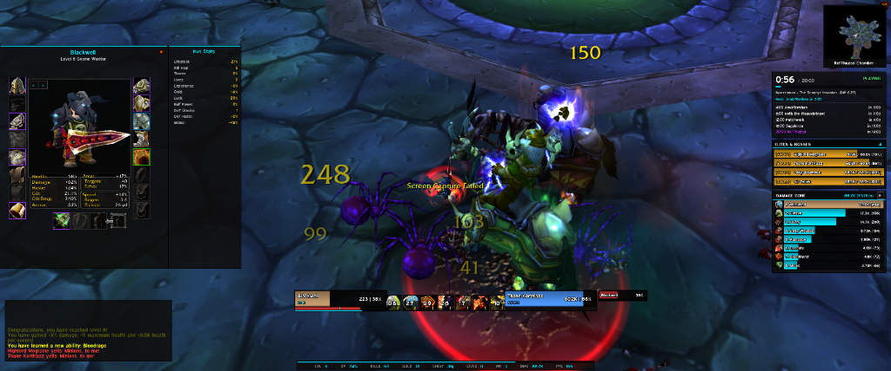
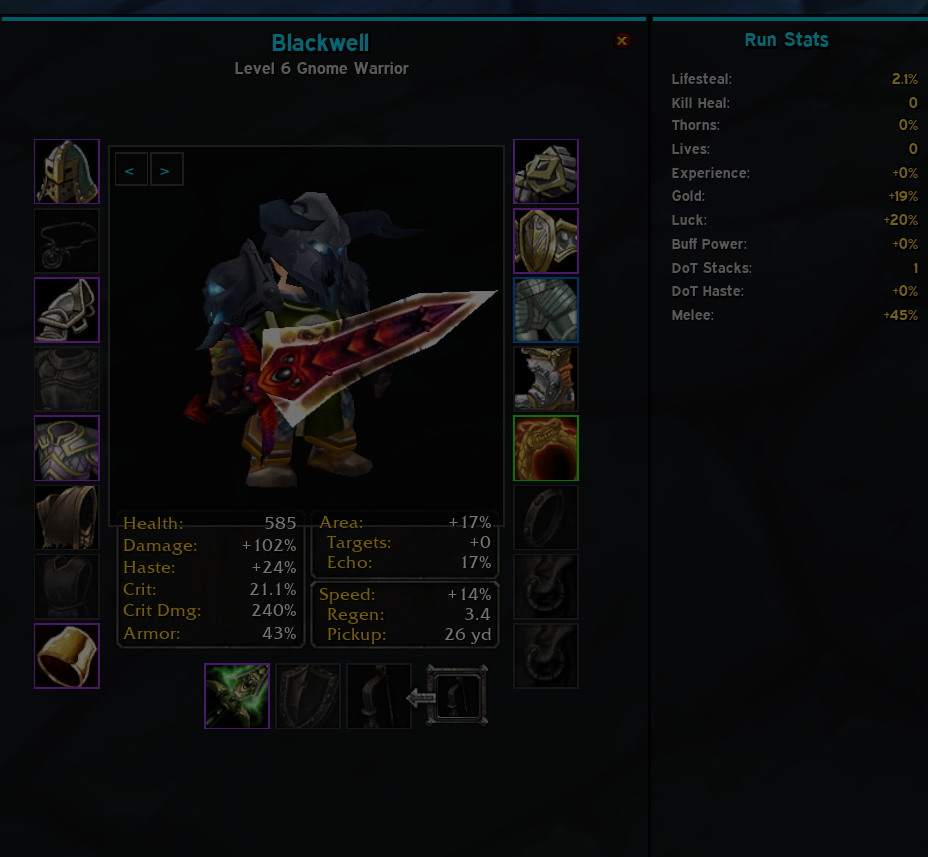
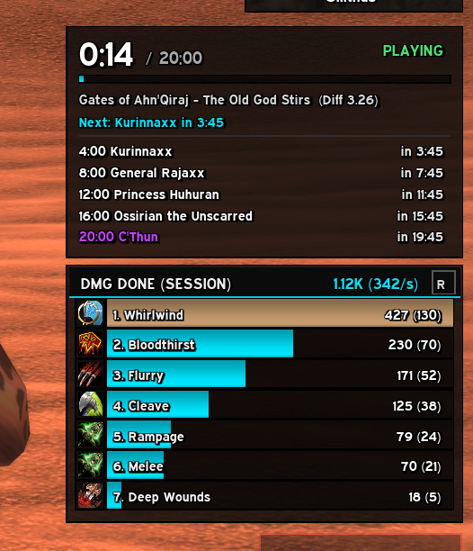

# BlackwellUI (BUI) // CYBERPUNK TACTICAL HUD FOR AZEROTH SURVIVORS

> **BlackwellUI** is a lightweight, high-performance tactical HUD overhaul engineered from scratch specifically for the **Azeroth Survivors** game mode on World of Warcraft (Vanilla 1.12.1).

---

## ⚡ What is Azeroth Survivors & BlackwellUI?

**Azeroth Survivors** transforms World of Warcraft 1.12.1 into an adrenaline-fueled reverse bullet-hell / survival roguelite (*Vampire Survivors* style). Abilities trigger automatically, hordes of thousands of enemies swarm the arena, and millisecond build optimization decides victory or death.

Stock World of Warcraft UI (action bars, bag slots, micro menus, standard unitframes) is cluttered and counter-productive for this game mode. **BlackwellUI** completely purges all Blizzard UI overhead and replaces it with a razor-sharp tactical Cyberpunk HUD featuring 1px borders, dark translucent backdrops, Expressway typography, and real-time combat telemetry.

---

## 📸 In-Game Screenshots

### 1. Tactical Combat HUD (Naxxramas: The Scourge Invasion)

*Full in-game combat HUD during a Naxxramas run. Centered Hero & Target frames with ability cooldown matrix, streamlined chat panel, economy telemetry DataBar, encounter radar and damage meter on the right, and the overhauled character sheet on the left.*

 

### 2. Character Matrix & Run Stats Panel ('C' Key)

*Redesigned Character Info window: Crisp 3D model frame, item quality border highlights, zero redundant bottom tabs, and the Azeroth Survivors Run Stats panel cleanly docked to the right edge.*

 

### 3. Run Clock, Boss Schedule & Live Damage Meter

*Live 20-minute run clock with boss spawn countdowns (Gates of Ahn'Qiraj: Kurinnaxx, General Rajaxx, Princess Huhuran, C'Thun) stacked directly above the Damage Meter featuring ability icons, dynamic equipped weapon textures, DPS rates, and the interactive `[R]` session reset button.*

---

## 🚀 Key Features & Telemetry Modules

* **Zero-Clutter Philosophy:** Blizzard action bars, bags, and micro buttons are permanently hidden and suppressed. 100% of your screen is dedicated to combat visibility and threat tracking.
* **Minimap Radar Pins (`Pins.lua`):** Real-time spatial tracking for Caches (`AZS_CHESTS`) and Guardian Lairs (`AZS_GetLairs`). Includes square-minimap Chebyshev edge clamping, distance in yards, and a breathing neon beacon on primary objective lairs.
* **Centered Cooldown Manager & Real-time DoT Counter (`Build.lua`):** 36×36px spell tiles with dark cooldown swipe overlays, active rank badges, full ability tooltips, and **live DoT/Debuff counters** displaying active targets for bleeds (Rend, Deep Wounds), demoralizing shouts, fears, and totems.
* **Stored Level-Up Quick Button:** When *Store Level-Ups* is active, a glowing Cyberpunk `[ LEVEL UP READY (N) - PRESS Y ]` button surfaces right above your ability tiles for instant 1-click access (`AZS_OpenStoredLevels`).
* **Multi-Mode Analytics Meter (`Meter.lua`):** 4 selectable modes (**Damage Done**, **Boss Damage**, **Healing Done**, **Damage Taken**) with instant header cycling. Features the **`[R]` Session Reset Button** and hover tooltips showing % share, DPS, and **Biggest Critical Strike** achieved during the run.
* **Guardian 8:00 Speedrun Tracker (`Timer.lua`):** Integrated live goal tracker inside the run timer monitoring the *"Slay 4 Guardians before 8:00"* speedrun achievement with status (`ACHIEVED`, countdown timer, or `EXPIRED`).
* **Kill Pace Telemetry (`DataBar.lua`):** 20-second rolling kill rate indicator in the bottom telemetry bar (`[85/m]`), dynamically color-coded by performance tier (Blazing Green, Fast Cyan, Steady Amber, Muted Red).
* **Loot Drop Telemetry Log (`Loot.lua`):** Compact, draggable feed capturing item drops from `CHAT_MSG_LOOT` with WoW quality colors (Gray to Legendary), run timestamps (`[04:12]`), and interactive hyperlink inspection.
* **Chat Spam Filter (`Chat.lua`):** Silently suppresses repetitive `Congratulations, you have reached level X!` and subsequent `+X% stat` spam floods to keep your communication pristine.
* **Target Debuff Aura Bars:** Stacks debuff bars directly above your target frame with square spell icons, spell names, remaining durations, and centered ticking damage values.
* **Cyberpunk Nameplates:** 120×10px statusbars, 1px contrast borders, neon reaction coloring (Hostile Red, Neutral Gold, Friendly Green), and dynamic accent borders for your active target.
* **Elites & Bosses Radar:** Tracks bosses, guardians, and elites in real-time with remaining HP and percentages. Supports **click-targeting** directly from the tracker row.
* **Live Stat Multipliers:** Displays active player multipliers (Damage, Cooldown Reduction, Crit, Area, Echo, Speed) parsed directly from `AZS_STATS`. Automatically hides when the Character Frame is opened to avoid screen overlap.

---

## ⌨️ Quick Controls & Commands

| Command | Action |
|---|---|
| `/bw` or `/bui` | Toggle the BlackwellUI Control Center (Themes, Accent Colors, Font Scale) |
| `/bw unlock` or `/bw move` | Unlock all HUD frames for drag-and-drop repositioning |
| `/bw lock` | Lock all HUD frames in place |
| `/bw reset` | Reset all frames to default screen layout |
| `/bw demo` | Toggle demo/preview mode with simulated combat data |
| `/bw hud` | Toggle replacement of the stock Azeroth Survivors run HUD |
| `/bw pins` | Toggle Minimap Radar Pins (Caches & Guardian Lairs) |
| `/bw loot` | Toggle the real-time Loot Drop Telemetry Log |

---

## 🔗 Links & Resources

* **GitHub Repository:** [github.com/Blackwellcode/BlackwellUI](https://github.com/Blackwellcode/BlackwellUI)
* **Releases & Downloads (`BlackwellUI.zip`):** [github.com/Blackwellcode/BlackwellUI/releases](https://github.com/Blackwellcode/BlackwellUI/releases)
* **Game Mode:** Azeroth Survivors (Custom Vanilla 1.12.1 Client)
* **Issue Tracker & Feature Requests:** [github.com/Blackwellcode/BlackwellUI/issues](https://github.com/Blackwellcode/BlackwellUI/issues)

---

## 🛡️ Engineering Standard

* **100% Strict Lua 5.0:** Engineered specifically for the WoW 1.12.1 client core (no `#` length operators, no `%` modulo operators, no string method calls).
* **Zero Texture Leaks:** Idempotent border and backdrop management (`buiEdges` caching), eliminating texture duplication and memory bloat.
* **Zero Hallucination Defensive Architecture:** Safe function-type checks across all Azeroth Survivors globals (`AZS_*`), guarded spellbook scanners, and plain-string substring matching to prevent regex pattern crashes.
