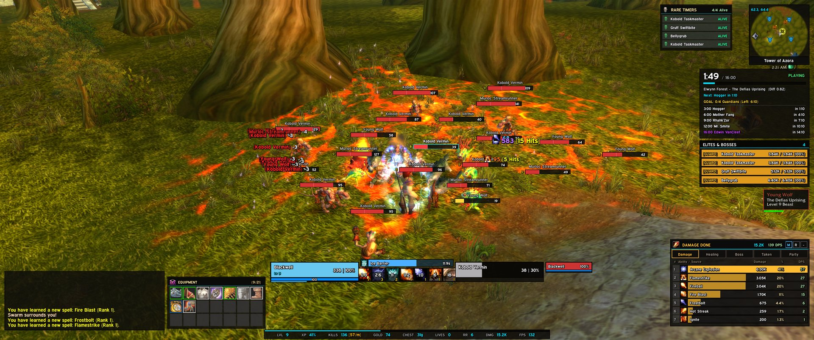
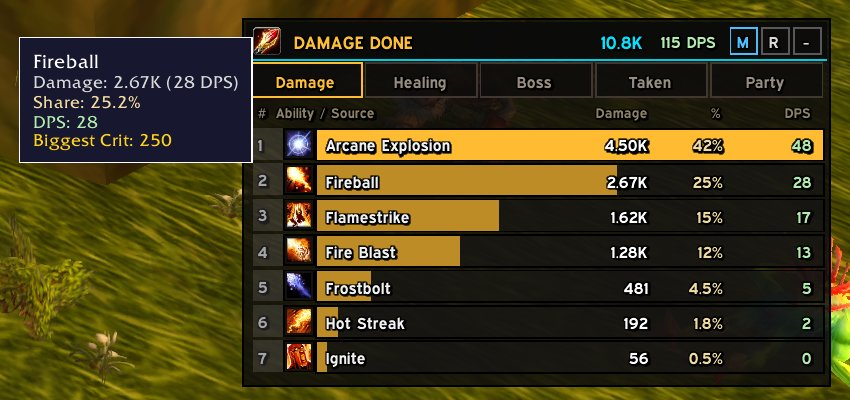
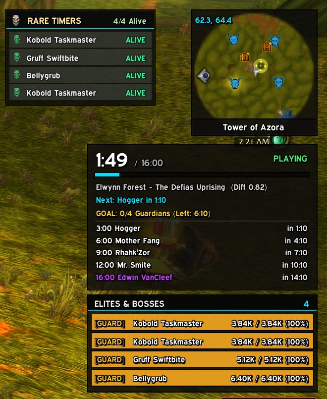
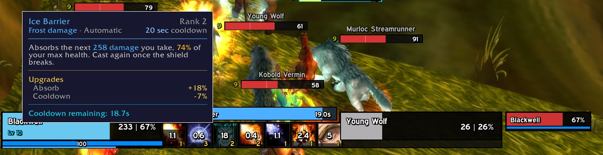
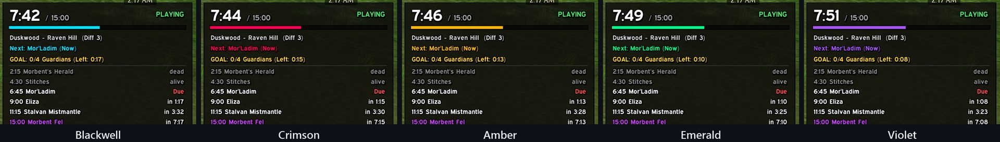
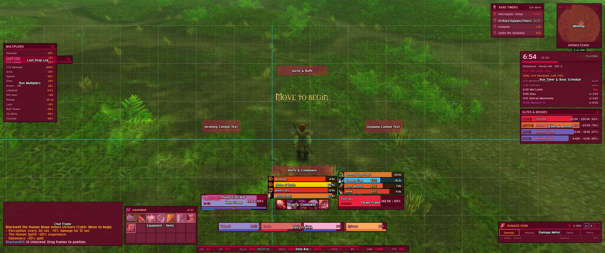
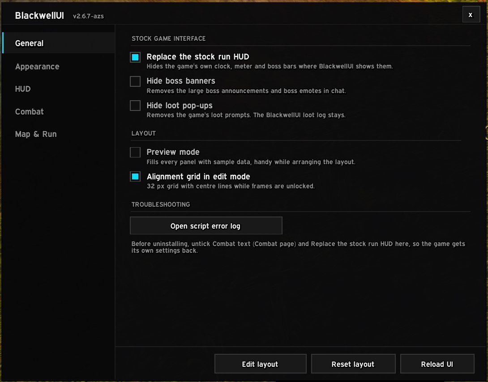
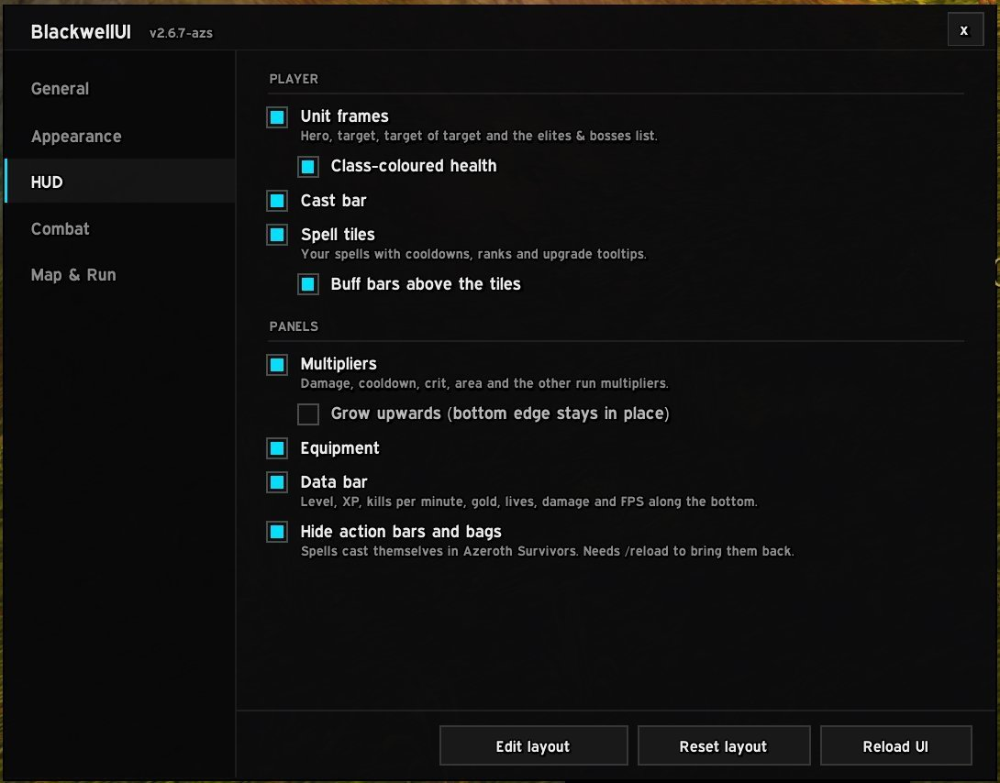

# BlackwellUI

**The tactical HUD and run-analytics suite for Azeroth Survivors.** 
See every number that decides a run: who deals the damage, when the next boss spawns, where the caches are.

&nbsp;

[Features](#features) · [Screenshots](#screenshots) · [Installation](#installation) · [Commands](#commands) · [FAQ](#faq) · [Report a bug](https://github.com/Blackwellcode/BlackwellUI/issues/new/choose)

---

## Why BlackwellUI

Azeroth Survivors turns the 1.12.1 client into a horde-survival roguelite: spells fire on their own, the screen fills with enemies, and a run is won or lost on build decisions. The stock interface was made for a different game.

BlackwellUI replaces it with one dark, 1px-bordered HUD that puts the run in front of you:

| | |
|---|---|
| **Know your damage** | A five-tab meter (Damage, Healing, Boss, Taken, Party) with share, DPS, biggest crit and item-proc merging. |
| **Know the clock** | Run timer, next boss, the full boss schedule and the "4 Guardians before 8:00" goal in one panel. |
| **Know the map** | Minimap radar pins for caches and guardian lairs, rare spawn timers and a live elites & bosses tracker. |
| **Make it yours** | Drag every frame on a 32px alignment grid, pick one of five accent themes or your own colour, scale for any resolution. |

---

## Screenshots

**Left:** damage meter with per-spell breakdown on hover. **Right:** rare timers, radar minimap, run clock with boss schedule, elites & bosses tracker.

  

Spell tiles with live cooldowns, rank badges and tooltips that list every upgrade on the spell.

  

Five accent themes plus a custom RGB colour; every bar, header and accent line follows it.

  

Edit mode (`/bw unlock`): every frame is labelled and snaps to a 32px grid with centre axes.

  

The control center (`/bw`): five pages, a plain-language hint under every setting, and options that only matter for a module stay greyed out while it is off.

---

## Features

<b>Combat analytics</b>

- **Damage meter** with five tabs: Damage, Healing, Boss, Taken, Party. Click the header to cycle, or a tab to jump.
- **Hover breakdown** per spell: damage, DPS, share of the total and biggest crit.
- **Proc merging** (`M` button): folds item procs such as `Amulet of the Inferno: Consecration` into the spell they belong to.
- **Session reset** (`R` button): left-click starts a fresh session, right-click returns to run totals.
- **Party drilldown**: in the Party tab, click a player to see their spells, hits and crits.
- **Floating combat text** in its own style: outgoing and incoming numbers, multi-hit merging (`223 (9 Hits)`), ability alerts. Blizzard's numbers are hidden while it is on and come back when you turn it off.

<b>Run intelligence</b>

- **Run clock** with run length, zone and difficulty, the next boss and the full boss schedule.
- **Guardian goal**: tracks the "4 Guardians before 8:00" objective right in the timer.
- **Elites & bosses tracker** with HP and percent; click a row to target it.
- **Rare spawn timers** for every lair: alive, fighting, or the time until respawn.
- **Data bar** along the bottom: level, XP, kills with a rolling kill pace (`[57/m]`), gold, lives, total damage and FPS at a glance.
- **Loot log** with quality colours and run timestamps.

<b>Radar & map</b>

- **Minimap pins** for caches and guardian lairs; pins outside the map range stick to its edge so nothing is lost.
- **Square minimap** with a 1px border and player coordinates.

<b>Your build</b>

- **Spell tiles** with cooldown overlays, rank badges and full tooltips including all upgrades.
- **Buff bars** above the tiles for shrines, racials and procs (toggle with `/bw buffs`).
- **Level-up button**: with stored level-ups, a `LEVEL UP READY (N)` button appears above your spells.
- **Equipment panel** with every equipped item, quality-coloured.
- **Stat multipliers** panel: damage, cooldown, crit, area, speed, echo and more, read live from the game. It can grow upwards, so it fits above the chat as well as below the minimap.

<b>Layout & style</b>

- **Edit mode** with labelled movers, a 32px alignment grid and centre axes.
- **Auto scaling** that fits the layout to your resolution (ultrawide included; the screenshots are 3440x1440), or a fixed scale (`/bw scale 0.9`).
- **Themes**: Blackwell, Crimson, Amber, Emerald, Violet, Monolith, class colour or any custom RGB colour.
- **Fonts and bar textures** switchable in the control center; all textures are power-of-two for the WebGPU client.
- **Nameplates** in the same style, coloured by reaction and unit kind.
- **Chat cleanup**: optional filter for level-up spam.
- **Control center** (`/bw`) with five pages: General, Appearance, HUD, Combat, Map & Run. Every one of the 17 modules can be turned off on its own.

---

## Installation

### Windows client (`AzerothSurvivors.exe`)

1. [Download `BlackwellUI.zip`](https://github.com/Blackwellcode/BlackwellUI/releases/latest/download/BlackwellUI.zip).
2. Extract it so that the folder sits at `AzerothSurvivors\benilla-config\AddOns\BlackwellUI\` (the `.toc` file must be directly inside `BlackwellUI`).
3. Start the game and enter a zone. Type `/bw` for the control center.

### Browser client (WebGPU)

Install `BlackwellUI.zip` through the game's in-game **AddOns** dialog, then reload.

### Updating

Download the new zip and replace the `BlackwellUI` folder. Your settings live in `benilla-config\saved\BlackwellUI.lua` and are kept.

### Uninstalling cleanly

BlackwellUI hides the stock run HUD and Blizzard's floating damage numbers. Those are game settings, and the client only saves them while you play. **Before you delete the addon**, open `/bw`, untick **Combat text** (Combat page) and **Replace the stock run HUD** (General page); the game gets its own settings back straight away. Then remove the folder.

---

## Commands

| Command | Action |
|---|---|
| `/bw` | Open the control center (also `/bui`, `/blackwell`) |
| `/bw unlock` · `/bw lock` | Enter / leave edit mode |
| `/bw reset` | Reset all frame positions |
| `/bw grid` | Toggle the alignment grid in edit mode |
| `/bw demo` | Preview mode with sample data, useful for building a layout |
| `/bw hud` | Toggle replacing the stock run HUD |
| `/bw sct` | Toggle floating combat text |
| `/bw pins` · `/bw loot` · `/bw rares` · `/bw gear` · `/bw plates` | Toggle radar pins, loot log, rare timers, equipment panel, nameplates |
| `/bw buffs` | Toggle the buff bars above the spell tiles |
| `/bw autoscale` · `/bw scale 0.9` | Automatic or fixed UI scale (0.5 to 2.0) |
| `/bw help` | List all commands in chat |

---

## Compatibility

| | |
|---|---|
| Game | Azeroth Survivors (benilla engine, WoW 1.12.1 interface `11200`) |
| Windows client | Tested in-game on the 2026-11-01 client build |
| Browser client | Built for it: Lua 5.0 only, power-of-two textures, numeric and string class IDs. Reports welcome. |
| Other addons | Works next to `!BugGrabber` / `BugSack`. Turn off a BlackwellUI module if another addon draws the same element. |

---

## FAQ

**My floating damage numbers or the stock HUD are gone.** 
That is BlackwellUI replacing them. Untick *Combat text* (Combat page) or *Replace the stock run HUD* (General page) in `/bw` and they return immediately.

**I turned off the Chat, Minimap, Unit Frames, Character or Action Bars module and nothing changed.** 
These modules take over Blizzard frames, so switching them off needs a `/reload`. BlackwellUI asks you when you untick them.

**A frame is off-screen or in the wrong place.** 
`/bw unlock` to drag it back, or `/bw reset` to restore the default layout.

**I found a bug.** 
Please [open an issue](https://github.com/Blackwellcode/BlackwellUI/issues/new/choose) with your BlackwellUI version (shown in `/bw`), Windows or browser client, and the Lua error text if there is one (`/err` opens the script log).

---

## Support the project

BlackwellUI is free. If it makes your runs better, a coffee keeps the updates coming.

Stars help other players find the addon, too.

---

Made for <a href="https://wow.aethus.pl/">Azeroth Survivors</a>. Not affiliated with Blizzard Entertainment or the Azeroth Survivors developers. · <a href="https://github.com/Blackwellcode/BlackwellUI/releases">Changelog</a>

