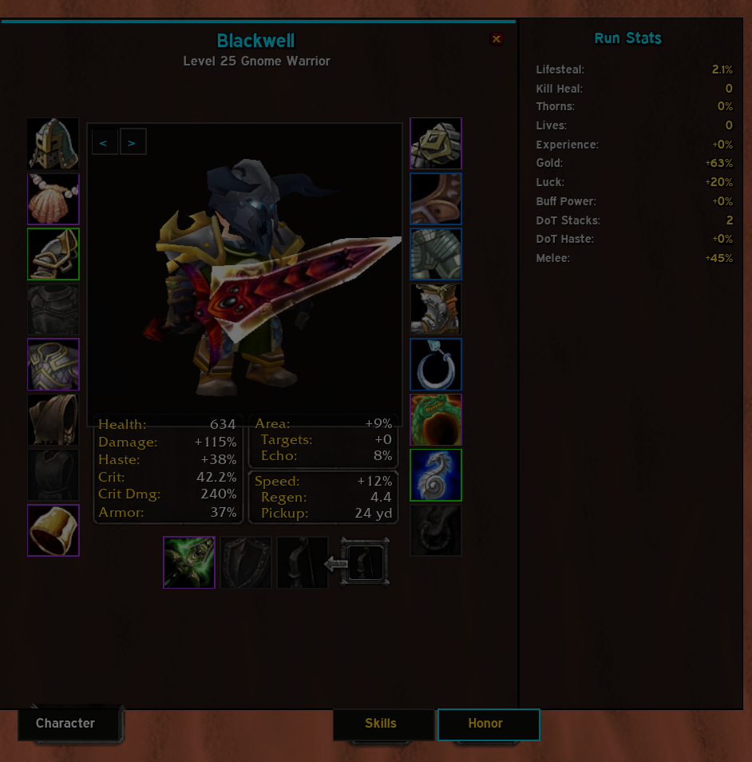
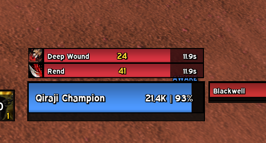

# BlackwellUI (BUI) // CYBERPUNK HUD FOR AZEROTH SURVIVORS

> **BlackwellUI** ist ein kompromissloses, hochperformantes Cyberpunk-HUD, entwickelt von Grund auf exklusiv für den Roguelite-Modus **Azeroth Survivors** auf WoW Vanilla 1.12.1.

---

## ⚡ Was ist Azeroth Survivors & BlackwellUI?

**Azeroth Survivors** verwandelt World of Warcraft 1.12.1 in ein rasantes Reverse-Bullet-Hell / Vampire-Survivors Survival-Game. Fähigkeiten lösen vollautomatisch aus, Wellen von tausenden Mobs stürmen auf den Helden ein und sekundengenaue Build-Optimierung entscheidet über Leben und Tod.

Das Standard-Interface von WoW (Aktionsleisten, Taschen, Blizzard-Menüs) ist für diesen Modus völlig ungeeignet. **BlackwellUI** radiert den Blizzard-Ballast restlos aus und ersetzt ihn durch ein taktisches Cyberpunk-HUD mit 1px-Borders, dunklen Panels und Live-Telemetrie.

---

## 📸 In-Game Screenshots

### 1. Tactical Combat HUD (Duskwood Run)

*Zentraler Cooldown-Matrix-Stack, Aura-Buff-Tracker mit echten Spell-Icons, dynamischer Encounter-Radar und schlanker Schadensmesser.*

 

### 2. Character Matrix & Run Stats Panel ('C'-Key)

*Vollständig überarbeitetes Charakterfenster: 3D-Modell, Item-Quality-Borders, keine überflüssigen Tabs und nahtlos rechts angedocktes Run-Stats-Panel.*

 

### 3. Target Frame & Debuff Aura Bars mit Tick Damage

*Reaktions-gefärbter TargetFrame mit 6 Debuff-Balken über dem Ziel, Tooltip-Namen, ablaufender Restdauer und zentriertem Ticking-Damage.*

---

## 🩸 Features auf einen Blick

* **Zero-Clutter Policy:** Sämtliche Blizzard-Aktionsleisten, Taschen und Micro-Buttons sind permanent eliminiert. Maximale Sicht auf die Gegnerhorden.
* **Cooldown-Manager & Tooltips:** 36×36px Ability-Kacheln mit Cooldown-Swipe, Rang-Badges und vollwertigem Blizzard-Tooltip bei Mouseover. Automatische dynamische Texturerkennung für Nah- und Fernkampfwaffen.
* **Cyberpunk Nameplates:** 120×10px Statusbars, 1px-Konturen, Reaktionsfarben (Neon-Rot, Gold, Grün) und dynamischer Akzentborder für das aktive Ziel.
* **Elites & Bosses Radar:** Erkennt Bosse, Wächter und Elites in Echtzeit, zeigt verbleibende HP/Prozente und unterstützt **Click-Targeting** via Linksklick direkt aus der Zeile.
* **Live Damage Meter:** Wechsel zwischen DMG Done und Taken. Inklusive **[R]-Reset-Button** (Linksklick: Session auf 0 / Rechtsklick: Gesamtrun wiederherstellen) und DPS-Berechnung.
* **Run Multipliers Panel:** Echtzeit-Auflistung aller aktiven Stat-Multiplikatoren (`AZS_STATS`) am linken Bildschirmrand. Blendet sich automatisch aus, wenn das Charakterfenster geöffnet wird.
* **Telemetry DataBar:** Bottom-Bar mit XP-Fortschritt, Level, Kills, Gold, **Next Chest Cost**, Leben, Rerolls und FPS.

---

## 🎛 Quick Controls

| Befehl | Aktion |
|---|---|
| `/bui` oder `/blackwell` | Öffnet das Steuerungszentrum (Themes, Farben, Font-Scale) |
| `/bui unlock` / `/bui move` | Alle HUD-Elemente frei per Drag & Drop verschieben |
| `/bui lock` | Alle Elemente verriegeln |
| `/bui reset` | Standardkoordinaten wiederherstellen |
| `/bui demo` | Demo-Vorschau mit simulierten Daten umschalten |

---

## 🔗 Links & Ressourcen

* **GitHub Repository:** [github.com/Seele2024/BlackwellUI](https://github.com/Seele2024/BlackwellUI)
* **Releases & Downloads (`BlackwellUI.zip`):** [github.com/Seele2024/BlackwellUI/releases](https://github.com/Seele2024/BlackwellUI/releases)
* **Azeroth Survivors Modus:** Standalone / Modded Vanilla 1.12.1 Client (*wenilla-rogue*)
* **Issue Tracker:** [github.com/Seele2024/BlackwellUI/issues](https://github.com/Seele2024/BlackwellUI/issues)

---

## 🛠 Engineering Standard

* **100% Strict Lua 5.0:** Entwickelt nach dem WoW 1.12.1 Standard (kein `#`-Operator, kein Modulo-Operator `%`, keine String-Objektmethoden).
* **Zero Texture Leaks:** Idempotente Texturverwaltung (`buiEdges`), keine endlosen Re-Skinning-Loops.
* **Zero Hallucination:** Defensiv programmierte API-Wrapper für `AZS_*` Globals, Spellbook-Scanner und Unit-Events.
